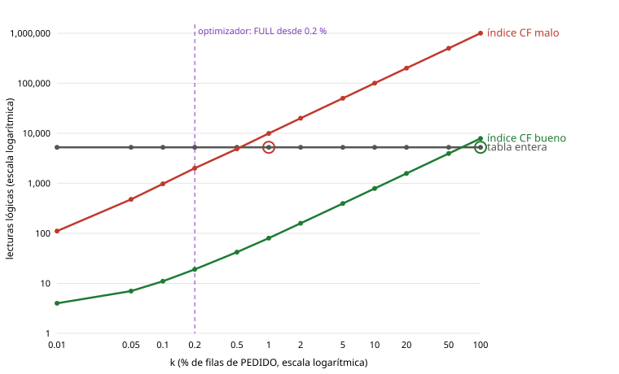

# Lab 5 — Respuestas

**Nombre:** César Pérez Montero
**Profesor:** Richard Aviles Lopez

---

## Parte A — Punto de partida, copia del Lab 4, Issue y branch

Partí de `main` con `lab3-final` y `lab4-final` publicadas, y con `16-verificacion-final.sh` del Lab 4 en TODO OK.

Copia `lab4-final` (evidencia 00):
- `backups/20261107T141931Z_lab4-final`, 1005 MB comprimida, 4 min 1 s.
- Las 4 sumas SHA-256 dan OK.
- **Paso 6: "ninguno: el volumen contiene toda la base de datos".**

Matiz respecto al enunciado: en mi entorno la copia del Lab 3 **también** dio 0 archivos fuera. Con la imagen oficial, `$ORACLE_HOME/dbs` enlaza al volumen, y los datafiles de V000 estaban dentro aunque en una carpeta no estándar (Lab 4, Parte A). La prueba de que la reubicación funcionó no está en el paso 6, sino en el inventario del paso 2:
- en Lab 3 los cinco `TBS_*` aparecían en `/opt/oracle/product/26ai/dbhomeFree/dbs/`;
- ahora aparecen en `/opt/oracle/oradata/FREE/FREEPDB1/`.

La copia ocupa algo más que la del Lab 3 (1005 MB frente a 958 MB) por V002, V003 y el redo archivado de la sesión del Lab 4.

## Parte B — El banco de pruebas TiendaSur y la herramienta de medida

V004 se aplicó en 34 s. Evidencias 01:

| Tabla | r | b | R (bytes) | bfr = r / b | MB |
|---|---|---|---|---|---|
| CLIENTE | 100 000 | 1517 | 102 | 66 | 11,9 |
| PEDIDO | 1 000 000 | 5320 | 32 | 188 | 41,6 |

- **CLIENTE** sale algo mayor que en el enunciado (1467 bloques, R = 98, bfr 68). Las fechas y los textos derivados del día de aplicación cambian un poco la longitud media de fila, como avisa el propio enunciado. Comprobación con la fórmula: b = ⌈100 000 / 66⌉ = 1516 frente a 1517 medidos.
- **PEDIDO** coincide exactamente: 5320 bloques y bfr 188.
- **Sesgos:** ES 60,1 %, Lorca 0,1 %, `Gonz%` 2,1 %, P 2 %, E 5 %, D 2,8 % y "último año" 33,3 %.
- **Histogramas:** FREQUENCY en `pais`, `estado` y `canal`; HYBRID en `ciudad`, con 2000 valores. Sin histograma, `estado` parecería un 25 % por valor.
- **Medida de prueba:** `lab_tools.medir.consulta('prueba_pk', …)` da filas = 1, **lecturas lógicas = 4** y físicas = 0, con `INDEX UNIQUE SCAN PK_PEDIDO` y `TABLE ACCESS BY INDEX ROWID`: 3 niveles de índice + 1 de tabla.

### Reto: el bfr de PEDIDO con mis manos (`scripts/lab5/01-reto-bfr.sql`)

| | Bloques con filas | Mín. | Media | Máx. | NUM_ROWS / BLOCKS |
|---|---|---|---|---|---|
| PEDIDO | 5220 | 2 | **191,6** | 200 | **188** |
| CLIENTE | 1477 | 22 | 67,7 | 71 | 65,9 |

Distribución de PEDIDO: 2301 bloques con 191 filas, 2867 con 192, 43 con 197, 7 con 196, 1 con 200 y 1 con 2.

**Por qué no todos los bloques tienen las mismas filas:**
1. **Las filas no miden lo mismo:** de 21 a 26 bytes de datos, 25,7 de media (VSIZE). Importes y fechas ocupan distinto según el valor. Con un bloque lleno hasta PCTFREE 10, cabe una fila más o menos según las que toquen: 191 o 192 casi siempre, y hasta 196-200 en los bloques con filas más cortas.
2. **La carga directa (`INSERT /*+ APPEND */ ... ORDER BY`) llena cada bloque hasta el límite y pasa al siguiente.** Por eso casi todos los bloques están en 191-192. El último bloque es el que se quedó con **2** filas: el resto del millón.
3. **NUM_ROWS / BLOCKS = 188 es menor que la media real (191,6)** porque `BLOCKS` cuenta los 5320 bloques bajo la HWM y solo 5220 tienen filas. Los 100 restantes son la cabecera del segmento, los bloques de mapa de bits de ASSM y espacio bajo la HWM sin usar. La media de las estadísticas reparte las filas también entre ellos. Es el mismo efecto de la Parte L del Lab 4.

En CLIENTE pasa lo mismo: de 22 a 71 filas por bloque y 67,7 de media, frente a 65,9 de las estadísticas.

### B1

**B.** E-Rows 25 000 frente a A-Rows 20 en `estado`: el optimizador supuso 1/NDV = 25 % porque le faltaba el histograma en una columna sesgada. En V004, `estado` tiene histograma FREQUENCY precisamente para que sepa que P es el 2 %. La fragmentación (A), las filas migradas (C) o la sargabilidad (D) no cambian las estimaciones de filas.

## Parte C — Anatomía de un índice: altura, ramificación, raíz y hoja

### C.1 Altura y factor de ramificación (evidencia 02-anatomia-indice)

`IX_PED_CLIENTE` (INDEX_STATS): altura 3, 1 000 000 entradas en 2216 hojas y 2215 entradas de rama en 6 bloques de rama.
- fo real = (2216 + 6 − 1) / 6 = **370**.
- fo máximo = 8028 / 14,8 = **543**.
- 451 entradas por hoja de 503 posibles: el **90 %**, por el PCTFREE 10 de la creación.
- 1 + ⌈log₅₄₃(2216)⌉ = **3**: coincide con INDEX_STATS.
- Proyección: con 20 millones de filas, altura 3; con mil millones, 4; con cien mil millones, 5.

Coincide con el enunciado: el índice se creó igual en los dos entornos.

Diccionario (bloque 1): todos los índices de PEDIDO tienen altura 3, y `PK_CLIENTE` altura 2. Avance de la Parte E: el CF de `PK_PEDIDO` e `IX_PED_FECHA` es **5220**, el número de bloques con filas (bueno). El de `IX_PED_CLIENTE` es **999 041** y el de `IX_PED_IMPORTE` **998 078**, casi el número de filas (malo).

### C.2 Lo que cuesta una búsqueda

`DISPLAY_CURSOR` de la segunda ejecución:
- `INDEX UNIQUE SCAN PK_PEDIDO` con **3 buffers** más `TABLE ACCESS BY INDEX ROWID` = **4**. Es la cuenta de la Unidad 3: altura 3 + 1 bloque de tabla.
- Si solo se pide `id_pedido`, la columna está en el índice y no hace falta ir a la tabla: **3** buffers.

### C.3 Raíz y hoja de PK_CLIENTE

- **Treedump:** `branch: 0x313 787 (0: nrow: 187, level: 1)` y hojas `leaf: 0x317 791 (-1: row:578.578 avs:8)`, `0x314 788 (0: row:571.571 avs:8)`…
- **Raíz:** `kdxconro 186` + `kdxbrlmc 791` (el hijo de la izquierda) = **187 hijos**, uno por hoja: altura 2. `row#0 … dba: 788` con clave separadora `c2 06 50` (= 579), `row#1 … dba: 789` con `c2 0c 33` (= 1150). Las ramas guardan separadores, no claves completas de cada fila.
- **Primera hoja (791):** `kdxconro 578` entradas, `kdxcoavs 8` bytes libres, `kdxleprv 0` (no tiene vecina a la izquierda) y `kdxlenxt 788`. Las hojas están enlazadas, por eso un rango recorre vecinas sin volver a la raíz.
- **`row#0 … data:(6): 00 00 03 1b 00 00`, `col 0: c1 02`:** el ROWID corto del índice bigfile, con 4 bytes de bloque (0x31B = **795**) y 2 de ranura (**0**), y la clave `c1 02` = **1**. Lo confirma `DBMS_ROWID`: el cliente 1 está en el bloque 795 (`0000031B`), ranura 0.

### C.4 Radiografía de las hojas

- **`PK_PEDIDO`:** 1875 hojas, 533 entradas por hoja, **99,9 %** de ocupación. Mapa entero `#`.
- **`IX_PED_CLIENTE`:** 2216 hojas, 451 por hoja, **89,7 %**. Mapa entero `=`; una sola hoja al 60-69 %, la última.

Ninguno es un patrón cola (no hay hueco a la izquierda). La diferencia entre los dos está en **cuándo y cómo se llenó cada uno**: la PK se mantuvo durante la carga con claves crecientes, y `IX_PED_CLIENTE` se creó después por ordenación, respetando PCTFREE 10.

### C1

**C. 4.** Con BLEVEL 2, la altura es 3: 3 lecturas de índice (raíz, rama y hoja) + 1 de tabla para la columna que no está en el índice. Es mi `PK_PEDIDO`: 3 + 1 = 4 buffers.

### C2

**C. 4.** Con fo 500, 2 000 000 hojas necesitan ⌈log₅₀₀(2 000 000)⌉ = ⌈2,33⌉ = 3 niveles de rama por encima de las hojas. La altura es 1 + 3 = **4**: 500² = 250 000 < 2 000 000 ≤ 500³.

### Reto: calcula antes de medir (`scripts/lab5/02-reto-email.sh`)

**1. Predicción a mano para `UX_CLI_EMAIL`** (100 000 entradas, 30 bytes por entrada y fo máximo 543):
- entradas por hoja = ⌊7996 · 0,9 / 30⌋ = 239;
- hojas = ⌈100 000 / 239⌉ = **419**;
- altura = 1 + ⌈log₅₄₃(419)⌉ = 1 + 1 = **2**. Una raíz bastaría, porque 419 < 543.

**2. Medida (VALIDATE STRUCTURE, que bloquea la tabla: solo en laboratorio):**

| Índice | Altura | Hojas | Ramas | Bytes/entrada hoja | Bytes/entrada rama | fo máx. | Entradas/hoja | PCT_USED |
|---|---|---|---|---|---|---|---|---|
| UX_CLI_EMAIL | **3** | **501** | 3 | **35,9** | **18,2** | **441** | 200 | 90 |
| PK_CLIENTE | 2 | 187 | 1 | 14,9 | 10,9 | 736 | 535 | 100 |

**Mi predicción falla, y por dos supuestos:**
- La entrada real mide **35,9 bytes**, no 30: el email medio ocupa 26 bytes (`AVG_COL_LEN`, Parte B), más el ROWID de 6 y la cabecera de entrada. Caben 200 por hoja y salen **501 hojas**, no 419.
- El fo de 543 era el de `IX_PED_CLIENTE`, cuya clave es un NUMBER de 3 bytes. **Las claves separadoras de rama de un email miden 18,2 bytes**, así que caben como mucho **441** hijos por bloque de rama.

Como 501 hojas > 441, una sola raíz no basta. Hacen falta 2 ramas por debajo de la raíz (3 bloques de rama) y **la altura sube a 3**. Por solo 60 hojas, el índice tiene un nivel más que la PK: **el fo depende del tamaño de la clave**. Un índice sobre una columna ancha es más alto que uno numérico con las mismas filas.

**3. Por qué los mapas son distintos aunque los dos tengan 100 000 entradas:**
- **`PK_CLIENTE`** está al **99,6 %** (`#`, 535 entradas por hoja). La PK existía durante la carga (`CONSTRAINT pk_cliente PRIMARY KEY` en el `CREATE TABLE` de V004) y las claves llegaron **en orden creciente** (`INSERT /*+ APPEND */ … ORDER BY n`). Cada hoja llena se dividió 90/10: la vieja se queda llena y la nueva recibe solo la clave nueva. Resultado: todas las hojas al ~100 %, menos la última (30-39 %), la que se estaba llenando.
- **`UX_CLI_EMAIL`** está al **89,6 %** (`=`, 200 por hoja). Se creó después de la carga (`CREATE UNIQUE INDEX` en V004), por ordenación de todas las claves, dejando el PCTFREE 10 de cada hoja. La única hoja al 0-9 % es la última.

Si los emails hubieran llegado en orden aleatorio con el índice ya creado, las divisiones habrían sido 50/50 y el histograma se habría ido al 60-75 % (Parte H). Ninguno de los dos mapas tiene hueco a la izquierda: no hay patrón cola.

## Parte D — Tipos de índice, medidos (evidencia 03-tipos-indice)

| Tipo | Consulta | Sin el índice | Con el índice | Lo que hay que ver |
|---|---|---|---|---|
| Único | Q13 por DNI | 1486 (FULL, porque mi CLIENTE tiene 1517 bloques) | **3** | Además impide el duplicado: `ORA-00001` y `ORA-03301 … (DNI:'00004711L') already exists`, que es la novedad de 23ai: dice qué valor choca |
| Compuesto (prefijo izquierdo) | Q6 Lorca | 144 (`INDEX SKIP SCAN`, solo ciudad) | 103 (`RANGE SCAN`, país + ciudad) | Sin la primera columna, Oracle salta país a país: funciona, pero es un parche |
| Compuesto / cubriente | Q7 historial | 15 (+ `SORT ORDER BY`) | 7 compuesto (`RANGE SCAN DESCENDING`, sin SORT) · **3** cubriente | Igualdad primero, rango después: filas ya ordenadas. El cubriente no toca la tabla |
| Funcional | Q1 `UPPER(email)` | 1486 | **4** | Funciona, pero es otro índice que mantener. Reescribir es mejor (Parte F) |
| "Parcial" (columna virtual) | Q12 pendientes | 246 (`estado, fecha`) | 239 | Lecturas parecidas, pero **54 hojas frente a 2933**: 54 veces menos que mantener, porque las claves NULL no entran en el B-tree |
| Bitmap | Q14, 4 filtros, 1 M filas | 4073 (FULL) | **528** (`BITMAP AND` de los 4) | Bitmap de región: 114 hojas frente a 1954 del B-tree equivalente |
| IOT | Q15 token | 4 (montículo + PK) | **3** | La tabla es el índice: se ahorra el salto a la tabla |
| Clúster hash | Q15 token | 4 | **1** (`TABLE ACCESS HASH`) | La clave es la dirección del bloque. Pero la limpieza por rango (`caduca < …`) lee la tabla entera: **2770** |

Coinciden con el enunciado todas las proporciones. La única diferencia son 1486 lecturas en lugar de 1436 en los FULL de CLIENTE, por sus 1517 bloques (Parte B).

**Sección 8, ningún índice es gratis.** `IX_PED_CLI_FEC_CUB` ocupa **40 MB**, casi la tabla entera (`PEDIDO`, 42 MB), y `IX_PED_PENDIENTES`, 0,5 MB. La limpieza dejó TiendaSur con sus **7** índices de partida.

### D1

**B.** Un bitmap en cada columna: baja cardinalidad, carga nocturna y filtros combinados a gusto. Mi Q14 pasó de 4073 a 528 lecturas con `BITMAP AND`, y el bitmap de región ocupa 114 hojas frente a 1954. Un B-tree compuesto (A) solo sirve si el filtro incluye su prefijo.

### D2

**A y C.** Evita ir a la tabla (Q7: de 7 a 3 lecturas) y encarece cada INSERT y cada UPDATE de sus columnas (Parte G). No siempre ocupa menos que la tabla (B): el mío ocupa 40 MB frente a 42. Oracle no tiene INCLUDE (D) y puede tener varias columnas (E).

### Reto: ¿haría cubriente IX_PED_FECHA para Q9? (`scripts/lab5/03-reto-q9.sql`)

Q9 actual: `COUNT STOPKEY > TABLE ACCESS BY INDEX ROWID PEDIDO > INDEX FULL SCAN DESCENDING IX_PED_FECHA`, con **5 lecturas lógicas** para 20 filas. La fecha sigue el orden físico de la tabla (CF de `IX_PED_FECHA` = 5220, Parte C): los 20 pedidos más recientes están juntos en 1-2 bloques de tabla.

**Decisión: no.** Q9 ya cuesta **5 lecturas** y un cubriente con todas las columnas solo ahorraría 1-2, a cambio de convertir un índice de 22 MB en otro de unos **40 MB**, casi la tabla entera (**42 MB**). Además, todo INSERT, y cada cambio de estado, tocaría un índice tan ancho como la fila.

## Parte E — Factor de agrupamiento y punto de equilibrio (evidencia 04)

| Índice | CF (diccionario) | CF calculado a mano (LAG sobre el bloque del ROWID) | Veredicto |
|---|---|---|---|
| PK_PEDIDO | 5220 | — | Bueno: igual a los 5220 bloques con filas |
| IX_PED_FECHA | 5220 | **5220** | Bueno |
| IX_PED_IMPORTE | 998 078 | — | Malo |
| IX_PED_CLIENTE | 999 041 | **999 041** | Malo: casi cada fila cambia de bloque |

El cálculo a mano coincide exactamente: el CF es cuántas veces cambia el bloque de tabla al recorrer el índice en orden. Es una propiedad de cómo está ordenada la **tabla**. `fecha_pedido` crece con el orden físico (V004 la cargó `ORDER BY n`) e `id_cliente` es aleatorio. Reconstruir el índice no lo cambiaría.

### Curva del punto de equilibrio (lecturas lógicas, segunda ejecución)

| k % | Filas | Índice CF bueno | Índice CF malo | Tabla entera | El optimizador elige (CF malo) |
|---|---|---|---|---|---|
| 0,01 | 100 | 4 | 111 | 5232 | índice |
| 0,1 | 1000 | 11 | 975 | 5232 | índice |
| **0,2** | 2000 | 19 | 2004 | 5232 | **recorrido completo** |
| 0,5 | 5000 | 42 | 4875 | 5232 | recorrido completo |
| **1** | 10 000 | 80 | **9920** | 5232 | recorrido completo |
| 10 | 100 000 | 789 | 100 167 | 5232 | recorrido completo |
| **100** | 1 000 000 | **7875** | 1 001 259 | 5232 | recorrido completo |

Teoría: con lecturas lógicas de igual coste, k/r < 1/188 = **0,53 %**; en disco, con c_sec/c_aleat = 1/5, **0,11 %**. El optimizador cambió entre el 0,1 % y el 0,2 %, igual que en el enunciado.

### Reto: dibuja tu curva (`scripts/lab5/04-reto-curva.py`)

Un script de Python con solo la biblioteca estándar lee la sección 3 de mi evidencia y dibuja las tres series en escala logarítmica de k y de lecturas. Marca con un círculo dónde cada índice cruza la tabla entera y con una línea discontinua dónde cambia el optimizador.



**Por qué los tres puntos no coinciden:**
1. **El optimizador cambia en el 0,2 %:** su modelo de coste supone que una lectura aleatoria de un solo bloque es más cara que una multibloque, así que penaliza el índice antes de que este lea más bloques que la tabla. Su umbral se acerca a (1/bfr) · (c_sec/c_aleat) = 0,11 %, no al 0,53 % de las lecturas lógicas.
2. **El índice con CF malo cruza la tabla en el 1 %:** cada fila es un bloque distinto. 10 000 filas son 9920 lecturas, casi el doble de las 5232 de la tabla. En lecturas lógicas, el punto real está entre el 0,5 % (4875) y el 1 %, cerca del 0,53 % teórico.
3. **El índice con CF bueno solo pierde al 100 %:** lee unas k/bfr hojas y bloques consecutivos. Al 100 % lee la tabla entera **más** el índice: 7875 frente a 5232.

### E1

**B.** Con CF = 9 950 000 sobre 10 M filas, el CF es malo (≈ r): pedir el 3 % son unas 300 000 lecturas aleatorias frente a 80 000 secuenciales. Es mi curva: el CF malo pierde ya en el 1 %. Reconstruir el índice (C) no cambia el CF, que depende del orden de la tabla.

## Parte F — Sargabilidad: consulta rota frente a reescrita (evidencia 05)

| Regla | Consulta rota | Lecturas | Reescrita | Lecturas |
|---|---|---|---|---|
| 1 · Función sobre la columna | `UPPER(email) = UPPER('Cliente4711@…')` | 1486 (FULL) | `email = LOWER('Cliente4711@…')` | **4** (`UX_CLI_EMAIL`, sin índice nuevo) |
| 2 · Aritmética sobre la columna | `fecha_pedido + INTERVAL '30' DAY >= CURRENT_DATE` | 5284 (FULL) | `fecha_pedido >= CURRENT_DATE - INTERVAL '30' DAY` | **321** (26 840 filas) |
| 3 · Conversión implícita | `codigo_postal = 30001` | 5232 (FULL) | `codigo_postal = '30001'` | **106** |
| 4 · Comodín a la izquierda | `apellidos LIKE '%ez'` | 1523 (FULL, 18 902 filas) | `LIKE 'Gonz%'` | 2024 por índice (2056 filas) |
| 5 · OR con una rama sin índice | `email = :t OR telefono = :t` | 1486 (FULL) | índice en las dos ramas (`BITMAP OR`) o `UNION` | **6** / **6** |

Regla 3: la prueba está en el plan, `filter(TO_NUMBER("CODIGO_POSTAL")=30001)`. Oracle convierte la **columna** a número, nunca el literal a texto, así que el índice de texto no sirve.

**Sargable no significa "usa el índice":**
- **Q4b `LIKE 'Gonz%'`** es sargable y va por índice, pero lee 2024 bloques, más que los 1486 de recorrer CLIENTE entera. El 2,1 % de clientes, con CF malo, está por encima del punto de equilibrio de la Parte E (1/66 ≈ 1,5 % en lecturas lógicas).
- **Q11 (ventas de 2025)** hace FULL (5232) en las dos versiones, y es lo correcto: un año es un tercio de los pedidos. Aun así, la versión con rango es mejor: tardó 25,7 ms frente a 108,5 ms, porque no calcula `EXTRACT` en un millón de filas, y deja que el optimizador estime bien las filas.

La limpieza devolvió TiendaSur a sus 7 índices.

### F1

**B.** `num_factura = 2025001` compara VARCHAR2 con NUMBER: Oracle aplica `TO_NUMBER` a la columna y el índice queda inutilizado. Es mi regla 3, con 5232 lecturas frente a 106. A, C y D comparan texto con texto, en igualdad o en rango por prefijo.

### F2

**A y C.** Las dos dejan `fecha` desnuda y cubren el día completo: `>= día AND < día siguiente`, o `BETWEEN` hasta las 23:59:59. B solo encuentra la medianoche exacta. D y E vuelven a envolver la columna.

### Reto: revisión de código (`scripts/lab5/05-reto-revision.sql`)

Comentario que dejaría en el Pull Request:

> **issue (blocking):** `WHERE SUBSTR(telefono, 1, 3) = '600' OR UPPER(apellidos) = 'GIL'` rompe la **regla 1** en las dos ramas (función sobre la columna) y, por eso, la **regla 5**: ninguna rama puede usar un índice y el OR lee CLIENTE entera. Medido con `lab_tools.medir.consulta`, con `ix_cli_telefono` e `ix_cli_apellidos` creados para la prueba: **1487 lecturas, TABLE ACCESS FULL**.
>
> **issue (blocking, funcional):** `apellidos` guarda los dos apellidos con mayúscula inicial ("Moreno Gil"). `UPPER(apellidos) = 'GIL'` **no devuelve ninguna fila** (0 en la base), así que hoy la consulta solo encuentra por teléfono. Hay 6121 clientes con "Gil" de segundo apellido y 0 de primero. ¿Qué queríais buscar?
>
> **suggestion:** desnudar las columnas:
> ```sql
> SELECT * FROM tiendasur.cliente WHERE telefono LIKE '600%' OR apellidos LIKE 'Gil %';  -- primer apellido Gil
> ```
> Con un índice en cada rama, Oracle hace `BITMAP OR` de los dos `RANGE SCAN`: **722 lecturas** (−51 %), con las mismas 981 filas. La versión con `UNION` se queda en 986 lecturas por la deduplicación.
>
> **question:** si lo que se busca es el **segundo** apellido, `LIKE '% Gil'` vuelve a romper la regla 4 (comodín a la izquierda) y no hay B-tree que la arregle. Haría falta Oracle Text o separar los dos apellidos en columnas (`apellido1`, `apellido2`) con su índice. Y ojo: `ix_cli_telefono` e `ix_cli_apellidos` no existen en producción, así que este cambio también exige una migración con su coste de escritura (Parte G). Y `SELECT *` en un panel: pedid solo las columnas que se muestran.

Los dos índices se crearon solo para la prueba y el script los borra al terminar (TiendaSur vuelve a 7 índices).

## Parte G — Protocolo de diseño de índices y coste de escritura (evidencia 06-indices)

### G.1 Lo que cuesta escribir (bloques modificados por fila, 2000 operaciones de una fila, deshechas)

| Escenario | Índices en PEDIDO | INSERT | UPDATE estado | UPDATE importe | DELETE | Redo por INSERT |
|---|---|---|---|---|---|---|
| Hoy (heredado) | 4 | **10,1** | 2 | 6 | 10,1 | 1305 B |
| Propuesta del compañero | 9 | **20,3** | 6 | 6 | 20,1 | 2667 B |
| V005 (nuestro diseño) | 5 | **12,2** | 8,1 | 6 | 10,1 | 1664 B |

- **INSERT ≈ 2 + 2 × índices:** 2 de la tabla (dato y undo) más 2 por índice (hoja y undo). Con 4 índices salen 10, con 9 salen 20 y con 5 salen 12: la fórmula se cumple casi exacta. Con la propuesta del compañero, **el redo por INSERT se duplica**: de 1305 a 2667 bytes.
- **UPDATE de estado:** cuesta 2 hoy porque ningún índice contiene `estado`. Con V005 cuesta **8,1**: el cubriente lleva `estado` (unos 4 bloques, entrada vieja fuera y nueva dentro) y `fecha_pendiente` cambia (unos 2). Es el precio, aceptado, de Q7 y Q12.
- **DELETE con V005:** 10,1, no 12. Las filas borradas (IDs 1-2000, antiguas, estado C) no tienen entrada en `ix_ped_pendientes`, así que el índice parcial solo cuesta en el 2 % de las filas.

### G.2 El protocolo aplicado a la propuesta (evidencia 06-indices, bloque del protocolo)

| Pregunta | Lo que dijo mi banco | Veredicto |
|---|---|---|
| 1 · Necesidad | Con Q2, Q3, Q7, Q8, Q9 y Q12 (reescritas), `DBA_OBJECT_USAGE` marca **sin uso** `IX_PED_CANAL`, `IX_PED_CLIENTE`, `IX_PED_FEC_CLI` e `IX_PED_IMPORTE`. Se usan `IX_PED_CLI_FEC` (Q7, 7 lecturas), `IX_PED_CP` (Q3, 106), `IX_PED_ESTADO` (Q12, 148 + SORT) e `IX_PED_FECHA` (Q2, Q8 y Q9) | No crear o retirar los cuatro sin uso |
| 2 · Viabilidad | `estado` tiene 4 valores (25 % por valor) y `canal` 3 (33 %): más del 0,5 % de equilibrio. `codigo_postal`: 0,009 % por valor | Estado y canal no son viables para igualdad. Para P, el índice parcial. CP sí |
| 3 · Escritura | INSERT de 10,1 a **20,3** bloques por fila con la propuesta | El doble de trabajo en cada escritura |
| 4 · Redundancia | `IX_PED_CLIENTE` es prefijo de `IX_PED_CLI_FEC`; `IX_PED_FECHA` es prefijo de `IX_PED_FEC_CLI` | Sobra uno de cada pareja, pero la FK `id_cliente` necesita un índice que **empiece** por ella |
| 5 · Ciclo de vida | `IX_PED_IMPORTE` se hizo INVISIBLE (VALID) y Q2 siguió con 329 lecturas por `IX_PED_FECHA` | Se retira por migración (V005) |

### G.3 La decisión versionada: V005

V005 se aplicó con `08` v2 (spool en `lab5/evidencia/spool`). Quedan exactamente **`IX_PED_CLI_FEC_CUB`, `IX_PED_CP`, `IX_PED_FECHA`, `IX_PED_PENDIENTES` y `PK_PEDIDO`** en PEDIDO, más `UX_CLI_DNI` en CLIENTE, todos VISIBLE. La justificación de cada índice va en la cabecera del propio archivo.

En la medida "Q12 pendientes" del protocolo, el compañero ganaba con `IX_PED_ESTADO` (148 lecturas + SORT) porque en ese momento no existía `IX_PED_PENDIENTES`. V005 lo resuelve con un índice de 54 hojas en lugar de uno de un millón de entradas que se actualiza en cada cambio de estado.

### G1

**B. `ALTER INDEX ... INVISIBLE`.** El optimizador lo ignora, Oracle lo sigue manteniendo y `VISIBLE` lo devuelve al instante: lo hice con `IX_PED_IMPORTE`. UNUSABLE (A) deja de mantenerlo y hay que reconstruirlo. DROP (C) obliga a recrearlo.

### G2

**B. Unos 1000.** Cada índice suma unos 2 bloques modificados por INSERT (hoja y undo; mi medida: de 10,1 a 12,2 con un índice más). 500 INSERT/s × 2 = unos 1000 bloques más por segundo, cada uno con su redo. Los índices se mantienen en cada sentencia, no al hacer COMMIT (D).

### Reto: defiende tu propio índice — V006 `IX_CLI_TELEFONO` (`scripts/lab5/06-reto-v006.sql`)

**Consulta que V005 no cubre: Q5**, identificar a quien llama al centro de atención (`email = :x OR telefono = :x`). Primero medí con el índice creado de forma temporal y borrado al final del script. Después lo propuse como V006 en una rama aparte (Issue #13, rama `feat/13-v006-ix-cli-telefono`, PR #14) y lo fusioné.

| Pregunta | Medida | Lectura |
|---|---|---|
| 1 · Necesidad | Q5 con OR: **1486 → 6** lecturas (FULL → `BITMAP OR` de `UX_CLI_EMAIL` e `IX_CLI_TELEFONO`). Solo por teléfono: **1486 → 3** | Sin índice en la rama del teléfono, todo el OR lee la tabla (regla 5) |
| 2 · Viabilidad | `telefono`: 100 000 valores distintos, 0,001 % por valor | Muy por debajo del umbral |
| 3 · Escritura | INSERT en CLIENTE: **10,1 → 12,2** bloques por fila, de 1366 a 1620 bytes de redo. 3 MB, 294 hojas | +2 bloques por alta de cliente: la fórmula de G.1 |
| 4 · Redundancia | Ningún índice de CLIENTE empieza por `TELEFONO` (`IX_CLI_PAIS_CIUDAD`, `PK_CLIENTE`, `UX_CLI_DNI`, `UX_CLI_EMAIL`) | No duplica a otro |
| 5 · Ciclo de vida | Crear `ONLINE`; observar `DBA_INDEX_USAGE` durante un ciclo completo (cierre de mes) | Si no se usa, `INVISIBLE` y después DROP por migración |

La migración está en `database/migrations/V006__ix_cli_telefono.sql`. Es idempotente como V005: si `IX_CLI_TELEFONO` ya existe, no hace nada. Se aplicó con `08-aplicar-migraciones.sh` (evidencia `spool/20261107T185314Z_06-V006__ix_cli_telefono.spool.log`). Desde entonces `06-reto-v006.sql` se niega a ejecutarse (ORA-20006), porque al terminar borraría el índice definitivo. `16-verificacion-final.sh` comprueba el índice y sigue dando TODO OK.

**Descripción del Pull Request:**

> **Summary:** add `IX_CLI_TELEFONO` (V006) so that Q5 can use an index on both OR branches.
> **Measured:** Q5 1486 → 6 logical reads; phone-only lookup 1486 → 3. Write cost: +2.1 blocks and +254 bytes of redo per customer INSERT; 3 MB. Not redundant with any existing index.
> **Decision needed:** worth it only if Q5 is a frequent call-center path. Customer INSERTs are much rarer than order INSERTs, so the write cost is small. Proposed rollout: create ONLINE, check `DBA_INDEX_USAGE` after a full month-end, and drop by migration if unused.

**Conclusión:** técnicamente compensa. Q5 pasa de 1486 a 6 lecturas con un coste de 2 bloques por alta de cliente, y las altas de clientes son mucho menos frecuentes que los pedidos. La pregunta 1 depende de la **frecuencia real** de Q5 en producción, que este banco no mide. Por eso el PR lo fusiona con una condición de ciclo de vida: revisar `DBA_INDEX_USAGE` tras un cierre de mes y, si no se usa, ponerlo `INVISIBLE` y borrarlo con otra migración. El diseño V005 de PEDIDO no cambia: V006 solo añade un índice a CLIENTE.

## Parte H — Divisiones de hoja, patrón cola y remedios (evidencias 07a, 07b, 07c y gráficos)

### H.1 Divisiones 50/50 y 90/10 (200 000 inserciones de una fila)

| Tabla | Divisiones | De ellas 90/10 | Hojas | Entradas por hoja | Llenado (gráfico) | Rango `k BETWEEN 1000 AND 1100` |
|---|---|---|---|---|---|---|
| AZAR | 595 | 0 | 596 | 336 | **75,4 %** (pico entre el 50 % y el 99 %) | — |
| CRECIENTE | 398 | **398 (todas)** | 399 | 501 | **99,9 %** | **4** lecturas |
| CRECIENTE con REVERSE | 511 | 0 | 512 | 391 | 77,9 % | **878** (TABLE ACCESS FULL) |

- **AZAR:** las divisiones 50/50 dejan las dos mitades a medias y el índice se estabiliza en el **75 %**, del orden del 69 % (ln 2) que predice la teoría para un árbol grande con claves al azar. El histograma va del 40 % al 99 %, nunca todo al 100 %, y el mapa mezcla `=` y `-` por todo el ancho.
- **CRECIENTE:** cada clave nueva es la mayor, así que Oracle deja la hoja vieja **llena** y abre una nueva (90/10). Con menos divisiones queda todo al 100 % (`#` de punta a punta).
- **REVERSE:** invierte los bytes de la clave y claves consecutivas caen en hojas distantes. Se reparte la "hoja caliente" de la derecha, pero las divisiones vuelven a ser 50/50 (78 %) y el índice deja de estar ordenado por la clave: un `BETWEEN` no puede usarlo y lee la tabla entera (878).

### H.2 El patrón cola

200 000 altas, 150 000 bajas de las más antiguas y otras 50 000 altas. Quedan 100 000 mensajes vivos, con IDs del 150 001 al 250 000.

| Medida | Valor |
|---|---|
| Hojas (VALIDATE STRUCTURE) | **425**, de ellas **224 vacías** (gráfico) |
| Entradas borradas que aún ocupan sitio (`DEL_LF_ROWS`) | **68 734** (41 %) |
| "Dame el siguiente mensaje" en la cola | **226** lecturas |
| La misma consulta en un índice sano (IX_CRECIENTE) | **2** lecturas |

Mapa: `[                                =###############################]`. La mitad izquierda está vacía y la derecha llena: es el **patrón cola**. Para la clave más baja, Oracle baja a la hoja de más a la izquierda, la encuentra vacía y salta de hoja en hoja hasta la primera entrada viva. Las claves nuevas siempre son mayores, así que esas hojas nunca se reutilizan. Mis cifras son algo menores que las del enunciado (452 hojas y 253 lecturas), pero la proporción es la misma: más de 100 veces lo de un índice sano.

### H.3 Los remedios, medidos

| Paso | Hojas | Borradas | MB del segmento | "Siguiente mensaje" | Qué hace y qué bloquea |
|---|---|---|---|---|---|
| 0. Cola degradada | 425 | 68 734 | 4 | 226 | — |
| 1. COALESCE | **201** | 0 | 4 | **2** | Fusiona hojas vecinas en línea, sin bloqueo. **No** devuelve espacio |
| 2. SHRINK SPACE | 201 | 0 | **1,69** | 2 | COALESCE + devuelve los bloques sobrantes al tablespace |
| 3. REBUILD ONLINE | 223 | 0 | 2 | 2 | Índice nuevo con PCTFREE 10 (89,7 % en el gráfico). Necesita espacio doble y genera mucho redo |

**COALESCE ya resuelve el síntoma** (de 226 a 2 lecturas) en línea y sin coste de espacio. SHRINK solo hace falta para devolver el espacio, y REBUILD no aporta nada aquí. La cura de verdad del patrón cola es de diseño: particionar por fecha y vaciar particiones enteras. Al final, el script borró el esquema de pruebas `LAB5_PRUEBAS`.

### H1

**B. COALESCE.** Es exactamente mi cola: de 226 a 2 lecturas en línea, sin bloquear la tabla y sin espacio doble. REBUILD (A) también lo arregla, pero es más caro. REVERSE (C) rompería los rangos. Las estadísticas (D) no tocan las hojas vacías: `DBMS_STATS` ni siquiera las cuenta.

### H2

**A y C.** REVERSE reparte la contención de la hoja de la derecha con claves crecientes y, como consecuencia, no puede usarse para un `BETWEEN` sobre la clave (mi rango: 878 lecturas con FULL frente a 4). No mejora los rangos (B) ni el CF (D), y no evita las divisiones (E): hizo 511, todas 50/50.

### Reto: diagnostica sin ver el script

**Pendiente:** depende de que el profesor cree el índice degradado en un esquema de pruebas. Cuando lo haga, el procedimiento está preparado:
1. `bash scripts/ops/grafico-indice.sh <ESQUEMA> <INDICE> "$EVID_LAB5/script/$(ts)_07-reto-diagnostico.script.log"`.
2. `ANALYZE INDEX … VALIDATE STRUCTURE` y `INDEX_STATS`, con `LF_BLKS`, `DEL_LF_ROWS` y `PCT_USED`.
3. Clasificarlo con la tabla de la Parte C:
   - **sano**: mapa uniforme y 80-100 %;
   - **inserciones al azar**: 60-80 %, estado estable, no se toca;
   - **fragmentado**: hojas por debajo del 50 % repartidas por todo el mapa;
   - **cola**: izquierda vacía y derecha llena.
4. Proponer el remedio mínimo (COALESCE, SHRINK o, solo con causa, REBUILD) y dar dos cifras antes y después: hojas y lecturas de la consulta afectada. El diagnóstico va como comentario en el Issue #11.

### Punto de control antes de la durabilidad

- **PK = 4 lecturas:** altura 3 de `PK_PEDIDO` + 1 de tabla (Parte C, `DISPLAY_CURSOR`: 3 + 1 buffers).
- **IX_PED_CLIENTE pierde al 1 %:** CF de 999 041. 10 000 filas son 9920 lecturas, frente a 5232 de la tabla entera (Parte E).
- **Q3 no usaba el índice:** `codigo_postal = 30001` se convierte en `filter(TO_NUMBER("CODIGO_POSTAL")=30001)`: 5232 lecturas frente a 106 con `'30001'` (Parte F).
- **Cada índice en un INSERT:** unos 2 bloques más por fila. Con 4 índices, 10,1; con 9, 20,3 (Parte G).
- **La cola leía 226 bloques para una fila:** 224 hojas vacías a la izquierda que la búsqueda de la clave más baja tenía que recorrer (Parte H).

## Parte I — SCN y checkpoints (evidencia 08-scn-checkpoint)

- **El SCN avanza solo:** 4 903 809 → 4 903 811 en 3 s sin que yo hiciera nada, por transacciones internas (MMON, jobs).
- **Antes del checkpoint:** `checkpoint_change#` 4 896 899 en el control file y en las cabeceras de `system01`, `sysaux01` (CDB$ROOT) y `academia01` (archivo 16): sincronizados.
- **Tras el UPDATE y `ALTER SYSTEM CHECKPOINT`:** todos los archivos abiertos pasan a **4 903 816** en el control file y en la cabecera.

### Punto de control

- **PDB$SEED se queda en 2 098 101** (archivos 2 y 4): está en READ ONLY. Nadie escribe en sus bloques y un checkpoint no tiene nada que llevar a sus cabeceras.
- **`ACTUAL_REDO_BLKS = 520 652`**, frente a 33 024 en el enunciado. Es el redo que todavía no cubre un checkpoint: la carga de TiendaSur, V005, las 800 000 inserciones de la Parte H y los 2000 × 4 DML × 3 escenarios de la Parte G. Hoy se archivaron unos 1500 MB de redo solo en la hora 14 (ver reto de K).
- **`ESTIMATED_MTTR = 46 s`** con ese redo pendiente; en el enunciado, 4-5 s. Con una carga diez veces mayor, la recuperación de instancia tendría que aplicar diez veces más redo y tardaría del orden de minutos. Lo acota **`FAST_START_MTTR_TARGET`** (aquí 0, sin objetivo): con un valor en segundos, Oracle hace checkpoints incrementales más frecuentes para no pasarse.

### Reto: el MTTR bajo carga (`scripts/lab5/08-reto-mttr.sql`)

Después de un checkpoint, `ACTUAL_REDO_BLKS = 10` y `RECOVERY_ESTIMATED_IOS = 10`. Tras el paso 1 de `13-lgwr-dbwn.sql` (UPDATE de las 20 000 filas y COMMIT, sin checkpoint) pasan a **16 017** y **592**: unos 8 MB de redo pendiente y casi 600 lecturas de bloques que la recuperación tendría que hacer.

`ESTIMATED_MTTR` se quedó en 46 s en las dos lecturas: Oracle lo recalcula de forma periódica, no al instante. **Relación:** el tiempo de recuperación de instancia crece con el redo generado desde el último checkpoint, porque cada bloque de redo hay que leerlo y cada bloque de datos tocado hay que releerlo y reescribirlo. Por eso un objetivo de MTTR se consigue forzando checkpoints más a menudo.

### I1

**B.** Al abrir, Oracle compara el SCN de checkpoint del control file con el de la cabecera de cada datafile, como mis columnas `ckpt_control_file` y `ckpt_cabecera`. Si coinciden y el cierre fue limpio, no hace falta recuperación.

## Parte J — Control files (evidencias 09)

- **Copias y secciones:** dos copias de 1146 bloques de 16 KB (`STATUS` vacío = sanas). Las secciones más usadas son `STANDBY DATABASE MATRIX` 128/128, `OFFLINE RANGE` 57, `DATAFILE` 26, `FILENAME` 26, `TABLESPACE` 23, **`ARCHIVED LOG` 23/28** y `LOG HISTORY` 23. `ARCHIVED LOG` está casi lleno porque mi base está en ARCHIVELOG desde el principio; con `control_file_record_keep_time = 7` días se reciclan.
- **`BACKUP CONTROLFILE TO TRACE`:** creó `controlfile_lab5.trc` dentro del volumen. Su `CREATE CONTROLFILE REUSE DATABASE "FREE" NORESETLOGS FORCE LOGGING ARCHIVELOG` (evidencia 09-create-controlfile) enumera los 3 grupos de redo de 200 MB y los 17 datafiles, incluido `tiendasur01.dbf`. Es la última defensa si se pierden todas las copias.
- **Multiplexación:** `control_files` va con `SCOPE = SPFILE` porque es estático. Después, `SHUTDOWN IMMEDIATE`, `cp -p control01.ctl control03.ctl` y `STARTUP`: **tres copias** de 18 792 448 bytes, todas sanas.

Las tres copias están en el mismo volumen: protegen de borrar o corromper **un** archivo (simulacro B), no de perder el disco.

### J1

**B.** Si falla una copia con la base abierta, la instancia se detiene: Oracle no sigue con las demás. Hay que sustituir la dañada por una copia sana (o quitarla de `CONTROL_FILES`) y arrancar. Lo haré en el simulacro B.

### J2

**A y C.** Nombre y ubicación de datafiles y redo (los veo en el `CREATE CONTROLFILE`) y el SCN del último checkpoint (Parte I). Los parámetros están en el SPFILE (B), las contraseñas SYSDBA en el password file (D) y el diccionario en SYSTEM (E).

## Parte K — Redo log (evidencia 10-redo)

- **Punto de partida:** mi base tiene **3 grupos de 200 MB** con 1 miembro (el enunciado tiene 2 de 20 MB). Secuencias 22 y 23 INACTIVE y archivadas, y 24 CURRENT.
- **Segundo miembro:** se añadió `redoNNb.log` a cada grupo. Aparecen **INVALID** hasta que LGWR escribe en ellos.
- **Dos `SWITCH LOGFILE`:** el grupo 1 pasó a CURRENT (25) y luego el 2 (26). `redo01b` y `redo02b` dejaron de estar INVALID, pero **`redo03b` siguió INVALID**: con 3 grupos, dos cambios no llegan a volver a escribir el grupo 3. Lo hará con el siguiente ciclo, y no es un error.
- **Errores que protegen la base:**
  - 4a, borrar el grupo CURRENT → `ORA-01623`;
  - 4b, borrar un miembro del CURRENT → `ORA-01609`;
  - 4c, borrar otro grupo → en mi base, **`ORA-00350: log 1 … needs to be archived`**, no el `ORA-01567` del enunciado. Con 3 grupos, borrar uno dejaría 2 (lo permitido), pero en ARCHIVELOG Oracle no deja tirar un grupo que aún no se ha archivado. Es otra protección distinta, por estar en ARCHIVELOG.

### K1

**C.** ACTIVE: ya no es el actual, pero sus cambios aún no están todos en los datafiles. Se necesitaría para una recuperación de instancia: es el grupo 3 tras el primer cambio de mi bloque 3. No está en uso por LGWR (A), no se puede borrar (B) y no tiene por qué estar archivado (D).

### Reto: dimensiona el redo de TiendaSur (`scripts/lab5/10-reto-redo.sql`)

Cambios de log de hoy por hora (UTC): **10 cambios y 1535 MB de redo en la hora 14**. Es cuando apliqué V004 (la secuencia 15 terminó a las 14:24:45, al cargar TiendaSur) y medí las Partes B-H. Las demás horas tienen 1 cambio. Las secuencias 17, 18, 22 y 23 duraron entre 13 y 30 s cada una: un grupo de 200 MB se llenaba en segundos.

Para que esa hora produzca como mucho 4 cambios: 1535 MB / 4 ≈ 384 MB por grupo. Propongo **512 MB** (margen para picos), con 3 grupos de 2 miembros. Comandos para migrar sin parar la base (no ejecutados):

```sql
ALTER DATABASE ADD LOGFILE GROUP 4 ('/opt/oracle/oradata/FREE/redo04.log', '/opt/oracle/oradata/FREE/redo04b.log') SIZE 512M;
ALTER DATABASE ADD LOGFILE GROUP 5 ('/opt/oracle/oradata/FREE/redo05.log', '/opt/oracle/oradata/FREE/redo05b.log') SIZE 512M;
ALTER DATABASE ADD LOGFILE GROUP 6 ('/opt/oracle/oradata/FREE/redo06.log', '/opt/oracle/oradata/FREE/redo06b.log') SIZE 512M;
-- llevar la escritura a los grupos nuevos y dejar los viejos INACTIVE y archivados
ALTER SYSTEM SWITCH LOGFILE;   -- repetir hasta que CURRENT sea el 4, 5 o 6
ALTER SYSTEM ARCHIVE LOG CURRENT;
ALTER SYSTEM CHECKPOINT;
SELECT group#, status, archived FROM v$log;   -- los grupos 1, 2 y 3 deben salir INACTIVE y ARCHIVED = YES
ALTER DATABASE DROP LOGFILE GROUP 1;
ALTER DATABASE DROP LOGFILE GROUP 2;
ALTER DATABASE DROP LOGFILE GROUP 3;
-- Oracle no borra los archivos: después, con el sistema operativo
-- rm /opt/oracle/oradata/FREE/redo0[123].log /opt/oracle/oradata/FREE/redo0[123]b.log
```

No se puede redimensionar un grupo existente. Y si se intenta borrar uno CURRENT, ACTIVE o sin archivar, Oracle lo impide (`ORA-01623` y `ORA-00350`, vistos en el bloque 4).

## Parte L — ARCHIVELOG y Fast Recovery Area (evidencias 11)

### L.1 Activar la FRA

- **Orden de los parámetros:** fijar la ruta sin tamaño dio `ORA-02097` + `ORA-19802: cannot use DB_RECOVERY_FILE_DEST without DB_RECOVERY_FILE_DEST_SIZE`. Con el orden correcto (`db_recovery_file_dest_size = 4G` y después la ruta `/opt/oracle/oradata/fra`, dentro del volumen) los dos parámetros quedaron en memoria y en el SPFILE (4 294 967 296 bytes).
- **Sin reinicio:** mi base **ya estaba en ARCHIVELOG** desde el principio (Lab 4, Parte A: `ENABLE_ARCHIVELOG=true` en la imagen oficial). El script lo detecta ("no hace falta reiniciar") y se salta el `SHUTDOWN IMMEDIATE → STARTUP MOUNT → ALTER DATABASE ARCHIVELOG → OPEN`.
- **El cambio de verdad está en el destino.** `ARCHIVE LOG LIST` pasa de `$ORACLE_HOME/dbs/arch` a **`USE_DB_RECOVERY_FILE_DEST`**. En `v$archived_log` se ve la frontera: las secuencias **24 y 25** salen como `arch1_24_1237845575.dbf` y `arch1_25_…` (el destino por defecto en `dbs`). Las **26 y 27** salen como **`o1_mf_1_26_ogygkggb_.arc`** y `o1_mf_1_27_…`: nombres OMF dentro de `fra/FREE/archivelog/2026_11_07/` (comprobado con `find`).
- **Lo que no cambia:** los 25 archivados anteriores, más de 2 GB, siguen en `$ORACLE_HOME/dbs` y **no cuentan en la FRA**, que marca 0 MB usados. Sigue abierto el hallazgo de la autopsia del Lab 4: habrá que retirarlos con RMAN, después de copiarlos, para que la FRA sea el único sitio que vigilar.

### Punto de control

- **ARC0-ARC3:** el enunciado dice que en el Lab 4 no aparecían. **En mi base sí aparecían** (Lab 4, Parte H: 4 procesos ARCn y la PGA de ARC0 en la Parte G), porque mi base está en ARCHIVELOG desde el principio. Los archivadores existen siempre que la base está en ARCHIVELOG: copian cada grupo de redo lleno a su destino. En una base NOARCHIVELOG no tienen nada que hacer y no se arrancan.
- **Nombres `o1_mf_…`:** son nombres OMF. Oracle los genera dentro de la FRA en `FREE/archivelog/<fecha>/`, como mis secuencias 26 y 27.

### L.2 La FRA se llena (controlado)

1. **FRA reducida a 2 MB** (`SCOPE = MEMORY`, solo laboratorio) y UPDATE de las 20 000 filas: `ALTER SYSTEM ARCHIVE LOG CURRENT` devuelve **`ORA-16038: log 1 sequence# 28 cannot be archived`**, `ORA-19809: limit exceeded for recovery files` y `ORA-00312` con los **dos** miembros, `redo01.log` y `redo01b.log` (multiplexados en la Parte K).
2. **Estado:** grupo 1 (seq 28) **NO archivado / ACTIVE**, grupo 2 (seq 29) **NO / CURRENT**, grupo 3 (seq 27) archivado. En el alert log, a las 14:48:16, `ORA-19815: WARNING: db_recovery_file_dest_size of 2097152 bytes is 100.00% used` y `ORA-19809`.
3. **Con 3 grupos, la base todavía no se para:** queda un grupo archivado que LGWR puede reutilizar. En el enunciado, con 2 grupos, ambos quedan sin archivar. Con uno o dos cambios de log más, todas las sesiones se quedarían en "log file switch (archiving needed)".
4. **Solución:** la FRA vuelve a 4 GB y **ARCn reintenta solo**. Las secuencias 28 y 29 pasan a `ARC = YES` y el grupo 3 (seq 30) a CURRENT. FRA: 7,6 MB usados de 4096. El SPFILE nunca dejó de tener 4 GB.

### L1

**B.** Hay que fijar antes `DB_RECOVERY_FILE_DEST_SIZE`: es exactamente el `ORA-19802` de mi paso 2. El parámetro es dinámico (C), no hace falta ARCHIVELOG para definir la FRA (A) y no tiene que ser ASM (D).

### L2

**A y C.** Aumentar el tamaño de la FRA si hay disco (mi paso 5: ARCn reintentó solo) o copiar los archivados con RMAN y borrarlos con `DELETE INPUT`, para que RMAN actualice el control file. Hacer `SWITCH LOGFILE` (B) no archiva nada. Pasar a NOARCHIVELOG en caliente (D) no se puede. Borrar con `rm` (E) deja a Oracle sin enterarse: después habría que hacer `CROSSCHECK` y `DELETE EXPIRED`.

## Parte M — Undo: lectura consistente y su coste en redo (evidencias 12)

### M.1 Dos sesiones sobre la fila 101

| Paso | Lo que vio B mientras A tenía el UPDATE sin confirmar |
|---|---|
| 1 | `101 ACTIVO`: el valor confirmado, aunque el bloque en caché ya diga EGRESADO |
| 2 | La transacción de A en `v$transaction`: segmento de undo 9, 1 bloque y 1 registro de undo, SID 69 |
| 3 | Bloqueos de A: **TM modo 3** sobre `ACA_ESTUDIANTES` y **TX modo 6** |
| 4 | `SELECT … FOR UPDATE WAIT 3` → **ORA-00054**, más `ORA-40097: … held by transaction ID 9.19.1035` (23ai dice qué transacción la retiene) |
| 5 | Tras el COMMIT de A: `101 EGRESADO` |
| 6 | Flashback Query (`AS OF TIMESTAMP … - 40 s`): `101 ACTIVO`, leído del undo |
| 7 | Reparación lógica con el undo: la fila vuelve a ACTIVO, como pide el checklist |
| 8 | `undo_retention = 900`, `v$undostat`: 352 bloques de undo, 357 transacciones, 0 `ORA-01555` |

### Punto de control

- **Paso 1:** B no lee el bloque tal como está en la caché. Oracle ve en la ITL que la transacción que lo modificó no está confirmada para el SCN de la consulta de B. Construye una **copia consistente del bloque** aplicando el undo de A (el valor anterior, ACTIVO): lectura consistente.
- **Paso 4:** leer no necesita bloqueo, pero `FOR UPDATE` sí: pide un bloqueo de fila, y la fila ya la tiene A con su TX en la ITL del bloque. Lectores y escritores no se bloquean; dos escritores sobre la misma fila, sí.
- **Paso 6:** el cambio está confirmado, pero **el undo sigue ahí**: Oracle lo conserva al menos `UNDO_RETENTION` (900 s) si hay espacio en UNDOTBS1. Flashback Query reconstruye la fila de hace 40 s con ese undo. Hasta dónde se puede mirar atrás lo limitan `UNDO_RETENTION` y el tamaño del tablespace de undo (o `RETENTION GUARANTEE`).

### M.2 El undo también genera redo (10 000 pedidos)

| Operación | Bloques de undo | Redo total | Redo que describe el undo | Redo del ROLLBACK |
|---|---|---|---|---|
| INSERT | 142 (1136 KB) | 4825 KB | 2030 KB | 357 KB |
| UPDATE | 158 (1264 KB) | 4304 KB | 1436 KB | 2470 KB |
| DELETE | **427 (3416 KB)** | **6627 KB** | 3262 KB | **4700 KB** |

- **INSERT** deja poco undo: solo "borra este ROWID".
- **DELETE** guarda la fila entera y sus entradas de los 5 índices de V005: el triple de undo.
- **Todo cambio en el undo se protege con redo:** entre el 34 % y el 49 % del redo de cada operación describe el undo.
- **El ROLLBACK no es gratis:** deshacer el DELETE generó 4,7 MB de redo.

### Reto: el coste en la FRA (`scripts/lab5/12-reto-fra.sh`)

Archivé lo pendiente, medí `space_used` de la FRA (32 666 624 bytes) y repetí `12-undo-y-redo.sql`. Con `ARCHIVE LOG CURRENT`, la FRA pasó a 51 345 920 bytes: **creció 18 241 KB (17,8 MB)**.

- La columna "redo total" de la tabla de esa segunda ejecución suma 3961 + 1258 + 6621 = **11 840 KB**. Esa columna **no incluye el redo de los tres ROLLBACK** (345 + 751 + 4701 = **5797 KB**). Juntos dan **17 637 KB**.
- La diferencia restante, unos 600 KB, es redo que no es del script: actividad interna de la instancia en ese minuto (MMON, jobs, la limpieza diferida de los bloques tocados) y las cabeceras y el redondeo a bloque de los archivados.
- **Conclusión:** en ARCHIVELOG, la FRA crece con todo el redo, **incluido el de deshacer**. Un DELETE de 10 000 filas que acaba en ROLLBACK cuesta en la FRA como un DELETE y un INSERT. Por eso el runbook vigila la FRA y la Parte L recomienda alertar al 80 %.

En la segunda ejecución, el UPDATE dejó menos undo (71 bloques frente a 158) y menos redo (1258 KB frente a 4304). En la primera, los bloques de esos pedidos todavía arrastraban la limpieza diferida de V005 y de las Partes G-H, que también se protege con undo y redo.

### M1

**C.** B ve el valor confirmado anterior, reconstruido con el undo: mi paso 1 (ACTIVO mientras A ya tenía EGRESADO). No espera (D) ni da error (B), porque leer no bloquea.

### M2

**C. DELETE.** Guarda la fila completa y sus entradas de índice: 427 bloques de undo frente a 142 del INSERT y 158 del UPDATE.

### M3

**B y D.** `ORA-01555` (snapshot too old) aparece cuando el undo que una consulta larga necesita ya se ha sobrescrito. Se resuelve con más `UNDO_RETENTION` y más tablespace de undo, y, si el informe es crítico, con `RETENTION GUARANTEE`. El tamaño de los redo logs (A), NOARCHIVELOG (C) o `LOG_BUFFER` (E) no tienen que ver con el undo.

## Parte N — LGWR, DBWn y write-ahead logging (evidencia 13-lgwr-dbwn)

| Paso | Redo (KB) | Escrituras de LGWR | Commits | Bloques que escribe DBWn | Bloques sucios de la tabla |
|---|---|---|---|---|---|
| 0. Punto de partida (tras checkpoint) | — | — | — | — | 0 |
| 1. UPDATE de 20 000 filas + COMMIT | **1779** | 2 | 1 | **0** | **231** |
| 2. `ALTER SYSTEM CHECKPOINT` | 9 | 1 | 0 | **346** | **0** |

### Punto de control

- **Tras el COMMIT, ningún bloque de la tabla está escrito en el datafile:** DBWn = 0 y los 231 bloques siguen sucios en memoria. La garantía está en el **redo**: el COMMIT terminó cuando LGWR escribió esos 1779 KB en el redo log online (multiplexado desde la Parte K y archivado a la FRA desde la Parte L). Si la instancia cayera ahora, la recuperación rehará el cambio desde el redo. Es el write-ahead logging, y lo comprobaré en el simulacro A.
- **DBWn escribe 346 bloques aunque la tabla solo tenía 231 sucios:** el UPDATE también ensucia bloques de **undo** (y sus cabeceras de segmento), y `v$sysstat` cuenta toda la instancia, incluido el trabajo de fondo de ese minuto.
- **1779 KB de redo para un UPDATE que no cambia ningún valor:** Oracle no compara valores antes de escribir. Cada una de las 20 000 filas genera su cambio de bloque, su registro de undo y el redo de ambos. El enunciado midió 7685 KB porque en su primera ejecución el UPDATE también limpiaba los bloques que la carga de V002 dejó sin limpiar (limpieza diferida, Lab 4 Parte K). En mi base, esta misma tabla ya la habían actualizado entera las Partes I (reto de MTTR), L y M, así que solo queda el coste mínimo: unos 90 bytes de redo por fila.

### N1

**A.** "Commit complete" garantiza que el redo de la transacción está escrito en el redo log online: LGWR, evento "log file sync". Los bloques no tienen por qué estar en los datafiles (B): mis 231 seguían sucios. Tampoco tiene por qué estar archivado (C) ni haberse hecho un checkpoint (D).

### N2

**B y C.** DBWn escribe en un checkpoint (mis 346 bloques del paso 2) y cuando un proceso servidor no encuentra buffers libres. Nunca escribe por un COMMIT (A): mi paso 1 tuvo 0 escrituras de DBWn. Lo de "cada 3 segundos" (D) y "al terminar el log buffer" (E) es de LGWR.

## Parte O — Simulacros de fallo (game day, evidencias 14a-14d)

### Simulacro A — Caída de la instancia (`SHUTDOWN ABORT`)

Antes de la caída: 102 → EGRESADO **confirmado** y 103 → INACTIVO **sin confirmar**. Después de un `STARTUP` normal, el alert log cuenta la recuperación de instancia, sin intervención:
- `Beginning crash recovery of 1 threads`;
- `Recovery starting at checkpoint rba (logseq 32 block 4063), scn 4906760`;
- `read 19 KB redo, 32 data blocks need recovery`;
- `Completed redo application of 0.01MB` y `Completed crash recovery`.

Resultado: **102 = EGRESADO** (durabilidad: el roll forward con el redo lo rehízo) y **103 = ACTIVO** (atomicidad: el roll back con el undo deshizo lo no confirmado). El simulacro entero, del ABORT a healthy, duró **11 s**.

### Simulacro B — Pérdida de una copia del control file

Con la base parada se borró `control03.ctl`. `STARTUP` arrancó la instancia (`STATUS = STARTED`) y se detuvo con **`ORA-00205: error in identifying control file`**. El alert log dice cuál: `ORA-00202: control file: '/opt/oracle/oradata/FREE/control03.ctl'` y `ORA-27037: unable to obtain file status`. Reparación: `cp -p control01.ctl control03.ctl`, `ALTER DATABASE MOUNT` y `ALTER DATABASE OPEN`. Tres copias sanas en **10 s**.

#### Punto de control

- **Se detiene en NOMOUNT:** NOMOUNT solo necesita el SPFILE (Lab 4, Parte E). Montar es el paso que abre **todos** los control files de `CONTROL_FILES`, y basta que falte uno para que falle.
- **Basta copiar una copia sana:** las tres son idénticas, porque Oracle las escribe a la vez, y con la base parada ninguna cambia. El script toma el nombre de la sana de `v$controlfile` antes de parar. Con la base abierta no se puede hacer igual: el control file cambia continuamente (checkpoints y cambios de log) y una copia en caliente sería inconsistente. Además, la instancia ya se habría detenido al perder la copia.
- **Si se perdieran las tres:** `RESTORE CONTROLFILE FROM AUTOBACKUP` con RMAN (mi base genera autobackups: `c-1509902213-*` y los de `fra/FREE/autobackup`), `RECOVER DATABASE` y `OPEN RESETLOGS`. O, como último recurso, el `CREATE CONTROLFILE` de `controlfile_lab5.trc` (Parte J).

### Simulacro C — Borrado de una tabla y RTO de una restauración completa

1. **Copia previa `lab5-pre-simulacro`:** 1,7 GB, mayor que la de `lab4-final` porque el volumen ya incluye TiendaSur, V005 y la FRA.
2. **`DROP TABLE aca_matriculas` sin PURGE:** la tabla y sus 4 índices pasan a la papelera como `BIN$…`. `FLASHBACK TABLE … TO BEFORE DROP` la devuelve: **60 000** matrículas en segundos y sin perder nada.
3. **`DROP … PURGE`:** sin papelera, `ORA-00942`.
4. **`restaurar-estado.sh --si`:** **RTO = 251 s**. **RPO = los 4 s** entre la copia y el fallo: todo lo hecho en ese intervalo se habría perdido. Tras restaurar, 60 000 matrículas.

### Simulacro D — Se rompe el disco de un datafile (RMAN, base abierta)

1. **Copia RMAN de `TBS_ACADEMIA`** en la FRA (`o1_mf_nnndf_LAB5_SIMULACRO_D_….bkp`, más el autobackup del control file).
2. **Después de la copia,** 104 → EGRESADO confirmado y un cambio de log.
3. **`rm academia01.dbf`:** `ORA-01116` + `ORA-01110` + `ORA-27041 / Linux Error 2`.
4. **FREEPDB1 estaba en READ WRITE** al empezar, pero tras el `OFFLINE` quedó **MOUNTED**: me tocó el **camino 2**. En el alert log, CKPT registró `ORA-63999: data file suffered media failure` y Oracle cerró la PDB ("Completed: Pluggable database FREEPDB1 closed").
5. **Reparación:** `RESTORE DATAFILE 16` y `RECOVER DATAFILE 16` (`Recovery of Online Redo Log … Seq 33 … Seq 34`, `Media Recovery Complete`), `ONLINE` y `ALTER PLUGGABLE DATABASE FREEPDB1 OPEN`.
6. **La fila 104 salió EGRESADO** y se devolvió a ACTIVO. **RTO = 12 s** desde el OFFLINE hasta READ WRITE (13 s desde el fallo). **RPO = 0**.

Al reabrir, el alert log muestra además **`ORA-01113: file 26 needs media recovery` (`tiendasur01.dbf`)** y avisos "Recovering data file … from a fuzzy backup" en los archivos 14, 15, 17, 18, 19, 20 y 26. **No es un segundo fallo:** el cierre brusco de la PDB por `ORA-63999` dejó sus demás datafiles sin el checkpoint de un cierre limpio, y al abrir Oracle los recuperó solo con el redo online. Lo comprobé: `v$recover_file` vacío, los archivos 16 y 26 ONLINE, FREEPDB1 READ WRITE y `TIENDASUR.PEDIDO` con 1 000 000 filas.

#### Punto de control

- **Los tres errores del paso 4:** `ORA-01116` dice **qué número de archivo** no se puede abrir (16). `ORA-01110` da su **ruta** (`academia01.dbf`). `ORA-27041` + `Linux-x86_64 Error: 2: No such file or directory` dan la **causa en el sistema operativo**: el archivo no existe.
- **Camino 2:** CKPT intentó escribir en el archivo 16 y detectó el fallo de medio (`ORA-63999` en `FREE_ckpt_116.trc`). Desde 21c, Oracle cierra la PDB afectada para protegerla en lugar de dejarla abierta con un archivo roto. Por eso, tras el OFFLINE, FREEPDB1 estaba MOUNTED.
- **El 104 = EGRESADO** no viene de la copia, que es anterior al cambio: viene del **redo**. `RECOVER` aplicó, desde el SCN de la copia (5 911 472), el redo de las secuencias 33 y 34, el redo online del cambio de log que hizo el script.
- **C frente a D:**
  - **RTO:** restaurar **toda** la base costó **251 s** y restaurar **un** archivo, **12 s**. Unas 20 veces más rápido, porque solo se toca lo roto.
  - **RPO:** en C se pierde todo lo posterior a la copia en frío (4 s aquí; en la vida real, horas). En D es **0**: copia más redo archivado y online.

### Retrospectiva del game day

| Simulacro | RTO medido | RPO real | Qué me sorprendió | Qué cambiaría del procedimiento |
|---|---|---|---|---|
| A · Caída de instancia | ~11 s (ABORT → healthy) | 0 | Solo 19 KB de redo y 32 bloques que recuperar: el checkpoint reciente (Parte N) dejó poco trabajo a SMON | Nada en el procedimiento. En producción, fijar `FAST_START_MTTR_TARGET` para acotar el RTO con carga (mi MTTR estimado llegó a 46 s en la Parte I) |
| B · Control file perdido | ~10 s | 0 | Arranca la instancia (STARTED) y se para justo al montar; el alert log dice exactamente qué copia falta | Las tres copias están en el mismo volumen: en producción, en discos distintos. Y revisar que el autobackup del control file está activo, porque sin copias sanas sería otra historia |
| C · Tabla borrada con PURGE | **251 s** | Los 4 s entre la copia y el fallo | La papelera lo arregla en segundos, PURGE convierte el error en una restauración completa, y la copia ocupa ya 1,7 GB | Usar recuperación de tabla con RMAN (`RECOVER TABLE … UNTIL TIME`) en vez de restaurar toda la base: RPO 0 para el resto de tablas. Y restringir `DROP … PURGE` |
| D · Datafile perdido | **12 s** (13 desde el fallo) | **0** | Oracle cerró toda la PDB (`ORA-63999`): el impacto fue de toda FREEPDB1, no solo de un tablespace. Y el `ORA-01113` de otro archivo al reabrir asusta si no lo esperas | Documentarlo en el runbook (`docs/runbooks/perdida-datafile.md`). Copias RMAN programadas de todos los tablespaces, no una puntual antes del simulacro |

### O1

**B.** Tras un corte de luz, `STARTUP` basta: SMON aplica el redo online (roll forward) y deshace lo no confirmado (roll back), como en mi simulacro A. No hace falta `RECOVER` manual (A), no se restaura nada (C) y no se pierde lo confirmado (D): el 102 sobrevivió.

### O2

**B y D.** Copiar una copia sana sobre la perdida y montar (lo que hice), o quitar la copia perdida de `CONTROL_FILES` en el SPFILE, reiniciar y montar. A y C son para cuando no queda ninguna copia buena, y E no hace falta: los datafiles están bien.

### O3

**B.** `OFFLINE` del archivo, `RESTORE`, `RECOVER` y `ONLINE`: es mi simulacro D, con la base abierta y RPO 0. A cierra la base y abre con RESETLOGS. C se salta el `RECOVER` y el archivo quedaría con datos antiguos. D necesita Flashback Database y hace retroceder la base entera.

### O4

**D.** `RMAN RECOVER TABLE … UNTIL TIME` antes del DROP recupera solo esa tabla, desde las copias y el redo archivado, sin tocar las demás. A no sirve tras un `PURGE`: la papelera está vacía, como en mi simulacro C. B pierde los cambios de las otras tablas. C no funciona tras un DROP, porque Flashback Query no recupera la definición de la tabla.

## Parte P — Runbook de salud y verificación final

### P.1 Runbook de salud (`15-healthcheck.sql`, ejecutado como C##OPS_RO)

1. **Disponibilidad:** instancia OPEN desde las 15:02 (el reinicio del simulacro D), ARCHIVELOG y FREEPDB1 READ WRITE.
2. **Espacio:** ningún tablespace por encima del 80 %.
3. **Recuperabilidad:** FRA con 94 de 4096 MB (2,3 %), último archivado a las 15:03, **3** control files y **0** grupos de redo con un solo miembro.
4. **Capacidad:** 98 de 200 procesos (máximo 106) y 128 de 322 sesiones.
5. **Errores ORA- en 24 h:** se clasifican en el punto de control.
6. **Cambios de log por hora:** 18 en la hora 14.
7. **Copias RMAN:** la de `DATAFILE FULL` (38 MB, 6 s) del simulacro D.
8. **Índices que piden atención:** solo "sin estadísticas" en ADMIN_CLINICA, ADMIN_FINTECH, ADMIN_LOGISTICA y ADMIN_RETAIL. Son esquemas vacíos y es esperable; ya estaba en la autopsia del Lab 4.
9. **Undo:** 0 `ORA-01555` y 0 errores por falta de espacio.

### Punto de control

**Clasificación de los errores del bloque 5:**

| ORA- | Clase | Lo explica |
|---|---|---|
| `ORA-63999`, `ORA-01110` (archivo 16) y `ORA-01113` (archivo 26) | **Provocados por el laboratorio** | Simulacro D: datafile borrado a propósito, cierre de la PDB y recuperación automática al reabrir (Parte O) |
| `ORA-00202` (`control03.ctl`) y `ORA-205` al montar | **Provocados por el laboratorio** | Simulacro B (Parte O) |
| `ORA-00800 [Set Priority Failed] [VKTM]/[LGWR]` | **Ruido conocido del entorno** | Al contenedor le falta `CAP_SYS_NICE`; aparece en cada arranque (los reinicios de los simulacros). Clasificado en el Lab 4 (Parte E) |

Ninguno es un incidente real.

**18 cambios de log en una hora:** en mi base no son 69, porque los grupos son de 200 MB y no de 20 MB, pero siguen siendo muchos. Los provocaron la carga de V004 y las Partes B-H, que generaron unos 1,5 GB de redo en esa hora (reto de K), además de los cambios forzados en K, L y O. En producción, 18 cambios por hora indicarían que el redo es pequeño para la carga: checkpoints muy frecuentes y riesgo de "checkpoint not complete". El objetivo son unos 3-4 por hora en el pico: grupos de 512 MB, según mi reto de K.

**Si el bloque 7 saliera vacío en producción:** no hay ninguna copia RMAN. Hoy mismo haría una copia completa (`BACKUP DATABASE PLUS ARCHIVELOG`), comprobaría que el autobackup del control file está activo y programaría las copias diarias, con una alerta si una falla. Una base en ARCHIVELOG sin copias no se puede recuperar de la pérdida de un datafile: sería el simulacro D sin la línea 1.

### Reto: un umbral que dispare una alerta (`scripts/lab5/15-reto-alerta.sql`)

Elegí la sección de **recuperabilidad**. La consulta devuelve **una sola fila, `CRITICO: …`, solo** si la FRA no reclamable supera el 85 % **o** no hay ninguna copia RMAN `COMPLETED` en las últimas 24 h. Si saltan las dos condiciones, las une en el mismo mensaje.

Hoy devuelve **0 filas**: FRA al 2,3 % y 1 copia RMAN en 24 h. Uso `space_used - space_reclaimable`, porque los archivados ya copiados se pueden borrar solos y no deben despertar a nadie. Es la forma de enchufarlo a un sistema de alertas: "0 filas = bien".

### P.2 Verificación final

`16-verificacion-final.sh` da **TODO OK**, con todas las comprobaciones de A a P:
- copia `lab4-final` íntegra;
- TiendaSur 100 000 / 1 000 000, `LAB_TOOLS.MEDIR` VALID, índices de PEDIDO exactamente los de V005, DNI único, 0 invisibles y `LAB5_PRUEBAS` borrado;
- 3 control files, 0 grupos de un solo miembro, ARCHIVELOG, FRA de 4 GB en el SPFILE y redo archivado;
- filas 101, 102 y 104 en ACTIVO, 60 000 matrículas, copias RMAN y solo FREEPDB1;
- evidencias de la 00 a la 15, con `config/.env` y `backups/` fuera de Git.

---

## 8. Preguntas de comprobación

### Punto de partida y banco de medida (A, B)

**1.** En mi entorno, el paso 6 dice lo mismo en las dos copias: "ninguno". Con la imagen oficial, `$ORACLE_HOME/dbs` es un enlace al volumen (Lab 4, Parte A). La diferencia que demuestra la reubicación está en el **inventario** (paso 2):
- `lab3-final` listaba los cinco `TBS_*` en `/opt/oracle/product/26ai/dbhomeFree/dbs/academia01.dbf`…;
- `lab4-final` los lista en `/opt/oracle/oradata/FREE/FREEPDB1/`.

Demuestra que los datafiles están en su carpeta estándar del volumen y no dependen de un enlace que una imagen nueva podría cambiar.

**2.** bfr = r/b: CLIENTE 100 000 / 1517 = **66**; PEDIDO 1 000 000 / 5320 = **188** (Parte B). PEDIDO cabe casi el triple porque su fila mide **32 bytes**, con siete columnas numéricas o cortas. La de CLIENTE mide **102**: email de 26 bytes, apellidos de 19, DNI, nombre y teléfono. El bfr depende de la longitud de fila.

**3.** Porque la primera ejecución incluye trabajo que solo ocurre una vez: el análisis duro y la carga del cursor, la lectura física de los bloques que aún no están en caché y la limpieza diferida de los bloques recién cargados. En la Parte C, la primera búsqueda por PK costó más que las 4 de la segunda, y por eso el script la descarta. La segunda ejecución mide el trabajo estable, en caliente, y es comparable entre alternativas.

### Anatomía y tipos de índice (C, D)

**4.** `IX_PED_CLIENTE`: altura **3**, **2216** hojas y 6 bloques de rama; fo real = (2216 + 6 − 1)/6 = **370** y fo máximo 543. Con mil millones de filas: 2 208 969 hojas y altura **4** (5 lecturas por fila), según la proyección de mi evidencia 02.

**5.** `row#0[1200] … data:(6): 00 00 03 1b 00 00`, clave `c1 02`. Son 4 bytes de **bloque** `00 00 03 1b` = 0x31B = **795** y 2 de **fila** `00 00` = **0**, comprobado con `DBMS_ROWID`: el cliente 1 está en el bloque 795, ranura 0. No aparece el número de archivo porque `TBS_TIENDASUR` es **BIGFILE**: un solo datafile por tablespace, y el índice guarda un ROWID corto de 6 bytes.

**6.** Tres pruebas de la Parte D:
- **Único sobre DNI (Q13):** de 1486 lecturas a **3**, más la garantía de unicidad (`ORA-00001` + `ORA-03301` con el valor duplicado).
- **Compuesto cubriente (Q7):** 15 con `IX_PED_CLIENTE` y SORT, 7 con `(id_cliente, fecha)` y **3** con el cubriente. Igualdad y luego rango dan las filas ya ordenadas, y el cubriente no visita la tabla.
- **Clúster hash (Q15):** **1** lectura frente a 4 del montículo + PK, porque la clave es la dirección del bloque. Pero la limpieza por rango le cuesta **2770**: el hash no sirve para rangos.

### Agrupamiento, equilibrio y sargabilidad (E, F)

**7.** `IX_PED_FECHA` tiene CF **5220**, el número de bloques con filas, porque V004 cargó los pedidos `ORDER BY n` y la fecha crece con el orden físico: filas vecinas en el índice, vecinas en disco. `IX_PED_CLIENTE` tiene **999 041**, casi el número de filas, porque `id_cliente` es aleatorio. Lo calculé a mano con `LAG` y salen exactamente esos valores. **REBUILD no lo arregla:** el orden de las claves y el de las filas siguen siendo los mismos. Solo lo cambia reordenar la tabla, y eso empeoraría el CF de la fecha.

**8.** Según mi curva:
- **CF malo:** pierde frente a la tabla entera entre el **0,5 % (4875 frente a 5232) y el 1 % (9920)**.
- **CF bueno:** solo pierde al **100 %** (7875 frente a 5232).
- **Fórmula de la Unidad 3:** con lecturas lógicas de igual coste, 1/bfr = 1/188 = **0,53 %**; mi CF malo cruza justo ahí. Con c_sec/c_aleat = 1/5, el **0,11 %**, que es donde cambia el optimizador (entre 0,1 % y 0,2 %), porque su modelo encarece la lectura aleatoria.

**9.** `apellidos LIKE 'Gonz%'` es sargable: un rango por el principio de la cadena. Pero devuelve **2056** clientes, el 2,1 %, y el índice tiene CF malo respecto a CLIENTE: cada fila es casi un bloque distinto. 2024 lecturas son más que las 1486 de leer la tabla entera. El 2,1 % está por encima del punto de equilibrio de CLIENTE (1/66 ≈ 1,5 %): sargable no significa que compense usar el índice.

### Coste de escritura y mantenimiento (G, H)

**10.** Bloques modificados por INSERT: **10,1** con 4 índices, **20,3** con 9 (el compañero) y **12,2** con 5 (V005). Rechacé:
- **`IX_PED_ESTADO` e `IX_PED_CANAL`:** no viables, porque cada valor es el 25 % y el 33 % de la tabla, más del 0,5 % de equilibrio. Para "P", V005 usa el parcial de 54 hojas.
- **`IX_PED_FEC_CLI`:** sin uso en `DBA_OBJECT_USAGE` y, además, con `IX_PED_FECHA` como prefijo redundante.
- **`IX_PED_CLI_FEC`:** lo sustituye el cubriente, que empieza igual y además evita la tabla.
- **`IX_PED_CP`:** sí se aprobó (Q3: 106 lecturas, 0,009 % por valor).

**11.** Con los gráficos de la Parte H:
- **50/50 (`IX_AZAR`):** histograma repartido del 40 % al 99 %, media del **75 %** y mapa de `=` y `-` mezclados por todo el ancho.
- **90/10 (`IX_CRECIENTE`):** todas las hojas al 90-99 % (**99,9 %**) y mapa entero de `#`.
- **Cola (`IX_COLA`):** **224 hojas vacías** al 0-9 % y 199 llenas. El mapa tiene la izquierda en blanco y la derecha en `#`: `[                                =###…#]`.

**12.** **`ALTER INDEX … COALESCE`.** Funciona en línea, sin bloquear el DML ni necesitar espacio doble, y resuelve el síntoma: en mi prueba, de 226 a **2** lecturas y de 425 a 201 hojas. Si además quisiera devolver el espacio, `SHRINK SPACE` (también en línea). REBUILD no hace falta y genera mucho redo. La cura de fondo es particionar por fecha.

### SCN, control files, redo y FRA (I a L)

**13.** Compara el SCN de checkpoint del **control file** (`v$datafile.checkpoint_change#`) con el de la **cabecera** de cada archivo (`v$datafile_header.checkpoint_change#`). En mi evidencia 08 los dos valían 4 903 816 tras el `CHECKPOINT`: sincronizados. Si difieren, o el cierre no fue limpio, Oracle aplica redo desde ese SCN.

**14.** Protege del borrado o la corrupción de **una** copia: es mi simulacro B, que reparé copiando `control01.ctl`. **No** protege de perder el volumen entero, porque las tres se van juntas, ni de un error lógico que se escriba en las tres a la vez. En producción, cada copia va en un disco y una controladora distintos, o en ASM con redundancia, más el autobackup del control file en RMAN.

**15.** Estados del redo (evidencia 10):
- **CURRENT:** LGWR escribe en él (seq 26 tras el segundo cambio).
- **ACTIVE:** ya no es el actual, pero sus cambios aún no están todos en los datafiles. Se necesitaría para una recuperación de instancia (seq 24 y 25).
- **INACTIVE:** sus cambios ya están en los datafiles y se puede reutilizar si está archivado (seq 23 al principio).

Los tres borrados se rechazan porque dejarían a la base sin redo que necesita:
- 4a: `ORA-01623`, no se puede borrar el CURRENT.
- 4b: `ORA-01609`, ni un miembro del CURRENT.
- 4c: `ORA-00350`, el grupo 1 aún no está archivado. En ARCHIVELOG, borrarlo perdería redo que ninguna copia tiene.

**16.** La cadena de causas:
1. La FRA llega a su límite. A las 14:48:16 sale el aviso `ORA-19815: … 2097152 bytes is 100.00% used`.
2. ARCn intenta archivar el grupo lleno y falla (`ORA-19809: limit exceeded for recovery files`, `ORA-16038: log 1 sequence# 28 cannot be archived`).
3. El grupo queda **sin archivar** y LGWR no puede reutilizarlo.
4. Cuando todos los grupos estén llenos y sin archivar (con mis 3 grupos aún quedaba uno), toda sesión que genere redo se queda esperando en "log file switch (archiving needed)". Las conexiones nuevas reciben `ORA-00257`. La base deja de aceptar cambios hasta que hay espacio en la FRA.

### Undo, WAL y simulacros (M a P)

**17.** Con los pasos 1 a 4 de la evidencia 12:
1. B **lee** la fila 101 como ACTIVO mientras A la tiene en EGRESADO sin confirmar. B no espera: lee una versión consistente construida con el undo de A.
2. y 3. A tiene un registro de undo, TM modo 3 y TX modo 6.
4. B solo se bloquea cuando también quiere **escribir** (`FOR UPDATE WAIT 3` → `ORA-00054`).

Los lectores no bloquean a los escritores, y los escritores no bloquean a los lectores. Solo dos escritores sobre la misma fila se bloquean.

**18.** El INSERT solo necesita en el undo "borra este ROWID" (142 bloques). El DELETE tiene que guardar la **fila entera y sus entradas en los 5 índices**, para poder reinsertarla (**427** bloques). El ROLLBACK también genera redo porque deshacer es aplicar cambios a bloques de datos e índices, y todo cambio de bloque se protege con redo: 4,7 MB al deshacer el DELETE. Si la instancia cayera a mitad del ROLLBACK, habría que rehacerlo.

**19.** Justo después del COMMIT, la garantía está en el **redo log online**: LGWR escribió 1779 KB y el COMMIT esperó a esa escritura. Los 231 bloques de la tabla siguen **sucios en memoria**: DBWn = 0. Después del checkpoint, también están en los **datafiles** (DBWn escribió 346 bloques) y ese redo deja de ser necesario para una recuperación de instancia. Desde la Parte L, además, queda archivado en la FRA.

**20.** El alert log del simulacro A:
- `Recovery starting at checkpoint rba (logseq 32 block 4063), scn 4906760`, `read 19 KB redo, 32 data blocks need recovery` y `Completed redo application of 0.01MB`. Ese **roll forward** rehízo con el redo todo lo posterior al último checkpoint, también el cambio **sin confirmar** de 103 y su undo.
- Con la base abierta, el **roll back** deshizo con ese undo lo no confirmado.

Resultado: **102 = EGRESADO** (confirmado: durabilidad) y **103 = ACTIVO** (no confirmado: atomicidad).

**21.** C: **RTO 251 s** y **RPO = los 4 s** entre la copia y el fallo. D: **RTO 12 s** (13 desde el fallo) y **RPO = 0**. Son tan distintos porque en C se restaura **toda** la base desde una copia en frío y se pierde todo lo posterior a ella. En D se restaura **un** archivo y RMAN aplica el redo archivado y online hasta el último COMMIT. La FRA y ARCHIVELOG convierten una restauración en una recuperación.

**22.** Bloque 5 del runbook:
- `ORA-63999`, `ORA-01110` (archivo 16) y `ORA-01113` (archivo 26): **efecto del laboratorio**, simulacro D.
- `ORA-00202` (`control03.ctl`) y `ORA-205`: **efecto del laboratorio**, simulacro B.
- `ORA-00800 [Set Priority Failed]`: **ruido conocido** del contenedor (`CAP_SYS_NICE`, Lab 4).

**Ningún incidente real.**

---

## 9. Simulacro de examen 1Z0-182

| Pregunta | Respuesta | Dónde lo comprobé |
|---|---|---|
| S1 | **B** | Parte E: `IX_PED_CLIENTE`, CF 999 041; al 1 %, 9920 lecturas para 10 000 filas |
| S2 | **A y C** | Partes D y F: índice funcional (4 lecturas) o `email = LOWER(:e)` con el índice que ya existe (4) |
| S3 | **B** | Parte F: `filter(TO_NUMBER("CODIGO_POSTAL")=30001)` |
| S4 | **B** | Parte D: bitmaps en `VENTA_HECHO`, 4073 → 528 |
| S5 | **B** | Parte D: Q6 solo por ciudad → `INDEX SKIP SCAN IX_CLI_PAIS_CIUDAD` |
| S6 | **B** | Parte G: `IX_PED_IMPORTE` INVISIBLE (VALID) y Q2 sin cambios |
| S7 | **A y C** | Parte H: COALESCE (226 → 2 lecturas) y SHRINK SPACE (4 → 1,69 MB), los dos en línea |
| S8 | **B** | Parte H: REVERSE con 511 divisiones 50/50 y rango de 878 lecturas (FULL) frente a 4 |
| S9 | **C** | Parte G: UPDATE de `estado` hoy = 2 bloques, sin ningún índice afectado |
| S10 | **B** | Parte C: `UX_CLI_EMAIL` (fo 441, altura 3) frente a `PK_CLIENTE` (fo 736, altura 2) con las mismas 100 000 entradas |
| S11 | **A y C** | Parte D: `SYS_IOT_TOP_…`, 3 lecturas frente a 4 del montículo + PK |
| S12 | **B** | Parte I: `ckpt_control_file` frente a `ckpt_cabecera` |
| S13 | **C** | Parte I: CKPT apunta el SCN; DBWn escribe los bloques (Parte N) |
| S14 | **B y E** | Lab 4, Parte E: en NOMOUNT responden `v$instance` y `v$parameter`; `v$database` da ORA-01507 |
| S15 | **B** | Parte L (y Lab 4, Parte F); en mi base ya estaba en ARCHIVELOG desde la imagen |
| S16 | **B** | Parte K: un grupo INACTIVE y archivado se puede recrear con `CLEAR LOGFILE` sin perder nada |
| S17 | **A y C** | Parte M: lectura consistente (paso 1) y Flashback Query (paso 6) |
| S18 | **B** | Parte M: entre el 34 % y el 49 % del redo de cada DML describe el undo |
| S19 | **A** | Parte N: tras el COMMIT, DBWn = 0 y 231 bloques sucios; el redo está en el log online |
| S20 | **A** | Parte I: el MTTR (46 s) depende del redo pendiente; un objetivo menor obliga a checkpoints incrementales más frecuentes |
| S21 | **B** | Parte L: FRA llena → `ORA-16038` y grupos sin archivar |
| S22 | **B** | Parte O, simulacro D: `ALTER DATABASE DATAFILE 16 OFFLINE` primero |
| S23 | **B** | SYSTEM no se puede poner OFFLINE con la base abierta: se restaura y recupera en MOUNT (Lab 4, Partes C y E) |
| S24 | **B** | Lab 4, P17 y Parte J: en NOARCHIVELOG solo queda la copia en frío; es mi simulacro C, con RPO = tiempo desde la copia |
| S25 | **B y D** | Parte M: `undo_retention` 900, `v$undostat` con 0 ORA-01555 |
| S26 | **A** | Parte L: `v$recovery_area_usage` (ARCHIVED LOG, 2 archivos y luego más) |
